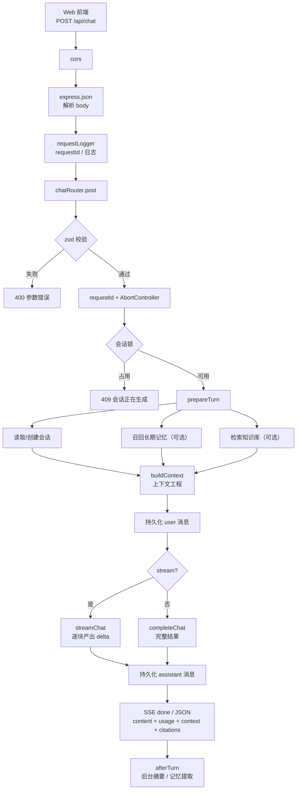
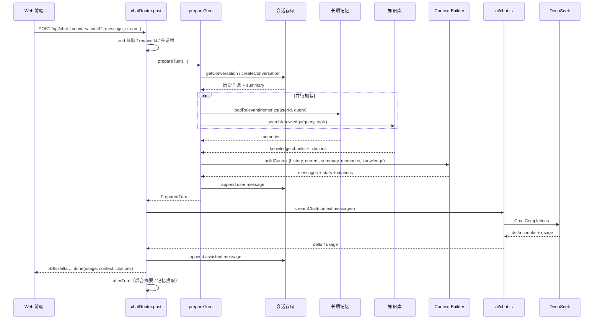

# 聊天请求处理地图

> 项目：openai-agent-lab
> 对应代码：`server/src/api/chat.ts` 中的 `chatRouter.post("/")`
> 最后更新：2026-10-21
> 目的：回答三个问题：
>
> 1. `chatRouter.post` 到底做了什么？
> 2. 上下文工程参与了吗？在哪一步？
> 3. 参数按什么顺序最终交给模型？

---

> [!TIP]
> **只想快速看调用顺序？直接跳到 [0.4 调用栈速查](#04-调用栈速查先看这一节)。**
> 一屏看懂正常聊天、非流式、中断请求分别调用了哪些函数。

## 0. 先给结论

### 0.1 你的理解对不对？

你的理解是：

```text
Web 前端 → API → server 拿到 request 参数 → 最终给到模型 → 返回给 Web
```

**起点和终点是对的，但中间少了一层最重要的东西：上下文工程。**

更准确的说法是：

```text
Web 前端
  → HTTP 中间件
  → chatRouter.post 校验 / 并发控制
  → prepareTurn 加载会话、记忆、知识
  → buildContext 做上下文工程（选择 + 排序 + Token 预算）
  → ai/chat.ts 调用模型
  → SSE / JSON 返回 Web
  → 持久化 assistant + 后台摘要/记忆
```

请求参数 **不是原样转发** 给模型的。前端传来的 `message` 只是“当前这一问”；模型真正看到的历史、摘要、长期记忆、知识库资料，都是服务端在 `prepareTurn → buildContext` 里补出来的。

### 0.2 上下文工程参与了吗？

**参与了，而且是核心步骤。**

它发生在 [server/src/conversation/chat.service.ts](server/src/conversation/chat.service.ts#L87-L154) 的 `prepareTurn()` 中，具体由 [server/src/context/context.builder.ts](server/src/context/context.builder.ts#L80-L190) 的 `buildContext()` 执行。

上下文工程负责四件事：

1. **选什么**：历史、摘要、长期记忆、知识库资料，哪些进入本次请求。
2. **排什么顺序**：system / 摘要 / 记忆 / 知识 / 历史 / 当前消息。
3. **占多少预算**：每块最多能用多少 Token。
4. **丢什么**：超出预算的历史、被过滤的失败消息、被截断的资料。

即使是旧版 `{ messages }` stateless 模式，也一样会经过 `buildContext()`，不是直接透传。

### 0.3 “参数顺序”不是一个顺序

这里实际有 **五层顺序**：

| 层级 | 顺序 | 对应位置 |
| --- | --- | --- |
| HTTP 中间件 | cors → JSON 解析 → 请求日志 → 路由 | `app.ts` |
| `chatRouter.post` 内部 | 校验 → requestId → 会话锁 → 准备上下文 → 调模型 → 回传 | `api/chat.ts` |
| `prepareTurn` | 策略 → 会话 → 记忆/知识 → 上下文组装 → 持久化 user | `conversation/chat.service.ts` |
| `buildContext` 预算 | system → 当前消息 → 输出预留 → 安全余量 → 摘要 → 记忆 → 知识 → 历史 | `context/context.builder.ts` |
| 最终 model `messages` | system → 摘要 → 记忆 → 知识 → 历史（旧→新）→ 当前 user | `context/context.builder.ts` |

下面逐层展开。

---

> [!IMPORTANT]
> **⭐ 全文速查入口：先看这一节的调用栈，再看后面的细节。**
>
> **30 秒版：** `chatRouter.post("/")` → `prepareTurn` → `buildContext` → `handleStreamResponse` → `initSse` → `sendSse`。

### 0.4 调用栈速查（先看这一节）

#### 先纠正一个容易混淆的点

按代码文件从上往下读，会看到：

```text
chatRouter.post("/abort")
  → prepareTurn
  → buildContext
  → handleStreamResponse
  → initSse
  → sendSse
```

这个顺序混了两件事：

| 你看到的 | 实际情况 |
| --- | --- |
| `chatRouter.post("/abort")` | 独立的 HTTP 接口，只有客户端调用 `POST /api/chat/abort` 时才执行 |
| `prepareTurn` / `buildContext` | 由 `chatRouter.post("/")` 调用，**不是** `/abort` 调用 |
| `handleStreamResponse` / `initSse` / `sendSse` | 同样在 `chatRouter.post("/")` 的流式分支里 |

原因：

```text
chat.ts 里的代码定义顺序：
  L276  chatRouter.post("/abort")
  L300  chatRouter.post("/")

但运行时顺序：
  正常聊天  → 只进入 post("/")
  中断请求  → 只进入 post("/abort")
```

> [!WARNING]
> **代码定义顺序 ≠ 运行时调用顺序。**
> `chatRouter.post("/abort")` 是独立接口，不调用 `prepareTurn` / `buildContext`。

#### 正常聊天（stream = true）的真实调用栈

```text
chatRouter.post("/")                          chat.ts L300
├─ chatRequestSchema.safeParse                chat.schema.ts L17
├─ getRequestId / new AbortController         chat.ts L311-L312
├─ registerActiveRequest                      active-requests.ts
├─ tryAcquireConversationLock                 conversation-locks.ts
├─ res.on("close")                            chat.ts L340
├─ prepareTurn                                chat.service.ts L87
│  ├─ resolveContextPolicy                    context.policy.ts L32
│  ├─ getConversation / createConversation    conversation.service.ts
│  ├─ loadRelevantMemories                    memory.service.ts L14
│  ├─ searchKnowledge                         knowledge.service.ts L38
│  ├─ buildContext                            context.builder.ts L80
│  │  ├─ estimateTokens / safetyMarginTokens  context.budget.ts
│  │  ├─ selectMemories                       context.selector.ts L107
│  │  ├─ selectKnowledge                      context.selector.ts L172
│  │  ├─ selectHistory                        context.selector.ts L55
│  │  └─ 组装 messages + citations + stats
│  └─ appendMessage(user)                     conversation.service.ts L57
├─ res.setHeader("X-Conversation-Id")         chat.ts L386
├─ handleStreamResponse                       chat.ts L166
│  ├─ initSse                                 sse.ts L18
│  ├─ streamChat(context.messages)            ai/chat.ts L68
│  │  └─ for await (delta chunk)
│  ├─ sendSse(delta)                          sse.ts L27   ← 每收到一块就发
│  ├─ finishTurn(assistant)                   chat.service.ts L157
│  ├─ sendSse(done)                           sse.ts L27
│  └─ afterTurn                               chat.service.ts L182
└─ finally
   ├─ unregisterActiveRequest
   └─ releaseConversationLock
```

#### 正常聊天（stream = false）的调用栈

```text
chatRouter.post("/")
└─ handleJsonResponse                         chat.ts L71
   ├─ completeChat(context.messages)          ai/chat.ts L45
   ├─ finishTurn(assistant)                   chat.service.ts L157
   ├─ res.json({ content, usage, context, citations, ... })
   └─ afterTurn                               chat.service.ts L182
```

非流式分支**不会**调用 `initSse` / `sendSse`。

#### 中断请求的调用栈

```text
chatRouter.post("/abort")                     chat.ts L276
├─ abortChatRequestSchema.safeParse
├─ abortActiveRequest(requestId)              active-requests.ts
│  └─ controller.abort("api")
└─ res.json({ ok: true })

与此同时，原来的聊天请求（另一个请求上下文）：
├─ streamChat 抛错 / 或正常结束
├─ 检查 controller.signal.aborted             chat.ts L194 / L236
├─ finishTurn(status = "aborted")
└─ sendSse({ type: "aborted" })
```

`/abort` **不调用** `prepareTurn`、`buildContext`、`handleStreamResponse`。它只做一件事：找到原来请求的 `AbortController`，调用 `abort()`。真正的收尾发生在原请求的流式循环里。

#### 10 个关键调用，按执行先后

| 顺序 | 调用 | 位置 | 作用 |
| --- | --- | --- | --- |
| 1 | `chatRouter.post("/")` | [chat.ts L300](server/src/api/chat.ts#L300) | 接收聊天请求 |
| 2 | `prepareTurn` | [chat.service.ts L87](server/src/conversation/chat.service.ts#L87) | 准备会话、记忆、知识、上下文 |
| 3 | `buildContext` | [context.builder.ts L80](server/src/context/context.builder.ts#L80) | 预算 + 选择 + 排序 |
| 4 | `handleStreamResponse` | [chat.ts L166](server/src/api/chat.ts#L166) | 进入流式分支 |
| 5 | `initSse` | [sse.ts L18](server/src/api/sse.ts#L18) | 写 SSE 响应头 |
| 6 | `streamChat` | [ai/chat.ts L68](server/src/ai/chat.ts#L68) | 调用模型并逐块产出 |
| 7 | `sendSse(delta)` | [sse.ts L27](server/src/api/sse.ts#L27) | 把增量写回 Web |
| 8 | `finishTurn` | [chat.service.ts L157](server/src/conversation/chat.service.ts#L157) | 持久化 assistant |
| 9 | `sendSse(done)` | [chat.ts L225](server/src/api/chat.ts#L225) | 发送结束事件与统计 |
| 10 | `afterTurn` | [chat.service.ts L182](server/src/conversation/chat.service.ts#L182) | 后台摘要 / 记忆提取 |

---

## 1. 一张总地图

### 1.1 请求全链路



### 1.2 Session 模式时序



---

## 2. 逐步拆解

### 2.1 进入 `chatRouter.post` 之前

位置：[server/src/app.ts](server/src/app.ts#L21-L28)

顺序固定，不能随意调换：

```text
1. cors
2. express.json({ limit: "1mb" })
3. requestLogger
4. 路由匹配 /api/chat
```

| 步骤 | 做了什么 | 为什么重要 |
| --- | --- | --- |
| `cors` | 处理跨域 | 前端 5173 直连 3001 时可用 |
| `express.json` | 把请求体解析为 `req.body` | 后面 zod 才能拿到对象 |
| `requestLogger` | 生成/透传 `X-Request-Id`，创建日志条目 | 中断、排查、上下文统计都靠它 |
| 路由匹配 | 进入 `chatRouter.post("/")` | 真正的业务编排从这里开始 |

`requestLogger` 还会：

- 把 `requestId` 写入 `res.locals.requestId`；
- 把日志条目写入 `res.locals.logEntry`；
- 在响应结束时记录状态码、耗时、`completed/closed`。

---

### 2.2 `chatRouter.post` 内部做了什么

> 运行时调用栈速查见本文 0.4 节；本节解释每一步的作用。

位置：[server/src/api/chat.ts](server/src/api/chat.ts#L300-L443)

按执行顺序拆成 11 步：

| 步骤 | 代码位置 | 做了什么 |
| --- | --- | --- |
| 1. 参数校验 | [L301-L306](server/src/api/chat.ts#L301-L306) | `chatRequestSchema.safeParse(req.body)`，失败返回 400 |
| 2. 判断模式 | [L308-L310](server/src/api/chat.ts#L308-L310) | 有 `message` → session；否则 stateless |
| 3. 生成请求控制 | [L311-L312](server/src/api/chat.ts#L311-L312) | 取 `requestId`，创建 `AbortController` |
| 4. 登记进行中请求 | [L314-L320](server/src/api/chat.ts#L314-L320) | 同一 `requestId` 重复 → 409 |
| 5. 会话锁 | [L322-L337](server/src/api/chat.ts#L322-L337) | 同一 `conversationId` 正在生成 → 409 |
| 6. 监听客户端断开 | [L339-L345](server/src/api/chat.ts#L339-L345) | 客户端关闭 → `controller.abort("client-close")` |
| 7. 写日志 | [L347-L371](server/src/api/chat.ts#L347-L371) | 记录模式、会话 ID、消息预览 |
| 8. 准备上下文 | [L373-L383](server/src/api/chat.ts#L373-L383) | `prepareTurn(...)`，上下文工程发生在这里 |
| 9. 回写会话 ID / 统计 | [L385-L395](server/src/api/chat.ts#L385-L395) | `X-Conversation-Id`，日志记录 context stats |
| 10. 中断检查 + 分支 | [L397-L426](server/src/api/chat.ts#L397-L426) | 已中断 → 499；否则走流式或非流式 |
| 11. 清理 | [L437-L441](server/src/api/chat.ts#L437-L441) | 注销 requestId，释放会话锁 |

#### 参数校验规则

位置：[server/src/api/chat.schema.ts](server/src/api/chat.schema.ts#L17-L62)

两种请求必须且只能选一种：

##### Session 模式

```json
{
  "conversationId": "uuid（可选）",
  "message": "只回复两个字：收到",
  "stream": true,
  "userId": "demo（可选）"
}
```

##### Stateless 模式

```json
{
  "messages": [
    { "role": "user", "content": "解释闭包" }
  ],
  "stream": true
}
```

校验点：

- `message` 与 `messages` 必须且只能提供一个；
- `conversationId` 只能和 `message` 一起使用；
- `messages` 最后一条必须是 `user`；
- 单条消息最多 8000 字符；
- stateless 最多 20 条消息；
- `stream` 默认 `true`。

#### 并发与中断控制

```text
requestId 重复          → 409
conversationId 正在生成 → 409
客户端断开              → abort("client-close")
POST /api/chat/abort    → abort("api")
```

- `requestId` 注册表：`api/active-requests.ts`
- 会话锁：`api/conversation-locks.ts`
- 两者都在 `finally` 中清理。

---

### 2.3 `prepareTurn`：上下文工程的入口

位置：[server/src/conversation/chat.service.ts](server/src/conversation/chat.service.ts#L87-L154)

这是 `chatRouter.post` 和 `buildContext` 之间的桥梁。

#### Session 模式执行顺序

```text
1. resolveContextPolicy()
   ↓ 读取 CONTEXT_STRATEGY / 预算 / 摘要 / 记忆 / 知识配置
2. getConversation(conversationId) 或 createConversation()
   ↓ 拿到历史消息 + summary
3. resolveUserId(request.userId ?? conversation.userId)
   ↓
4. Promise.all([
     loadRelevantMemories(userId, query),
     searchKnowledge(query, topK)
   ])
   ↓ 记忆和知识并行加载，互不阻塞
5. buildContext({
     history,
     currentMessage,
     summary,
     memories,
     knowledge,
     policy
   })
   ↓ 生成最终的 messages、citations、stats
6. appendMessage(conversationId, user 消息)
   ↓ 持久化当前用户消息
7. 返回 PreparedTurn
```

#### `resolveContextPolicy()`：先把“规则”定下来

位置：[server/src/context/context.policy.ts](server/src/context/context.policy.ts#L32-L58)

```ts
export function resolveContextPolicy(
  overrides: Partial<ContextPolicy> = {},
): ContextPolicy {
  const config = env.context;

  return {
    strategy: overrides.strategy ?? config.strategy,
    systemPrompt:
      overrides.systemPrompt ??
      (env.contextSystemPrompt || DEFAULT_SYSTEM_PROMPT),
    maxContextTokens: overrides.maxContextTokens ?? config.maxTokens,
    maxHistoryMessages:
      overrides.maxHistoryMessages ?? config.maxHistoryMessages,
    reserveOutputTokens:
      overrides.reserveOutputTokens ?? config.reserveOutputTokens,
    summaryThreshold: overrides.summaryThreshold ?? config.summaryThreshold,
    summaryKeepTurns: overrides.summaryKeepTurns ?? config.summaryKeepTurns,
    summaryMaxTokens: overrides.summaryMaxTokens ?? config.summaryMaxTokens,
    memoryEnabled: overrides.memoryEnabled ?? config.memoryEnabled,
    memoryLimit: overrides.memoryLimit ?? config.memoryLimit,
    memoryBudgetRatio:
      overrides.memoryBudgetRatio ?? config.memoryBudgetRatio,
    knowledgeTopK: overrides.knowledgeTopK ?? config.knowledgeTopK,
    knowledgeBudgetRatio:
      overrides.knowledgeBudgetRatio ?? config.knowledgeBudgetRatio,
  };
}
```

它不是“拼 prompt”，而是把**环境变量 + 调用方覆盖值**合并成一份**本次请求的上下文策略**。后面的 `buildContext()` 完全按这份策略做决策。

| 字段 | 来源 | 含义 | 用途 |
| --- | --- | --- | --- |
| `strategy` | `CONTEXT_STRATEGY` | `full` / `window` / `summary-window` | 决定是否使用摘要、历史条数上限 |
| `systemPrompt` | `CONTEXT_SYSTEM_PROMPT` 或内置默认 | 系统提示词 | 最终 messages 的第一条 system |
| `maxContextTokens` | `CONTEXT_MAX_TOKENS` | 上下文总预算 | 预算公式的起点 |
| `maxHistoryMessages` | `CONTEXT_MAX_MESSAGES` | 历史消息条数上限 | `window` / `summary-window` 使用 |
| `reserveOutputTokens` | `CONTEXT_RESERVE_OUTPUT` | 输出预留 Token | 从可用预算中扣除 |
| `summaryThreshold` | `CONTEXT_SUMMARY_THRESHOLD` | 摘要触发阈值 | 判断历史是否大到需要摘要 |
| `summaryKeepTurns` | `CONTEXT_SUMMARY_KEEP_TURNS` | 摘要时保留的最近轮数 | 只摘要更早的消息 |
| `summaryMaxTokens` | `CONTEXT_SUMMARY_MAX_TOKENS` | 摘要自身上限 | 防止摘要膨胀 |
| `memoryEnabled` | `MEMORY_ENABLED` | 是否启用长期记忆 | 决定记忆预算是否为 0 |
| `memoryLimit` | `MEMORY_LIMIT` | 召回记忆条数 | 取 Top N |
| `memoryBudgetRatio` | `MEMORY_BUDGET_RATIO` | 记忆预算占比 | 记忆区域的上限 |
| `knowledgeTopK` | `KNOWLEDGE_TOP_K` | 知识检索条数 | 取 Top K |
| `knowledgeBudgetRatio` | `KNOWLEDGE_BUDGET_RATIO` | 知识预算占比 | 知识区域的上限 |

> **一句话：** `resolveContextPolicy()` 是“定规则”，`buildContext()` 是“按规则执行”。

#### Session 模式的 1–7 步逐条解释

> [!IMPORTANT]
> **这 7 步是 Session 模式下 `prepareTurn` 的主线，顺序不能乱。**

| # | 调用 | 做了什么 | 什么意思 | 干什么用 |
| --- | --- | --- | --- | --- |
| **1** | **`resolveContextPolicy()`** | 读取 env 和 `overrides`，合并成 policy | 本次请求的“上下文规则书” | 后面的 `buildContext()` 按它分配预算、选择策略 |
| **2** | **`getConversation` / `createConversation`** | 按 `conversationId` 读取会话；没有就创建 | 找到这段对话的“记忆容器” | 拿到历史消息和 `summary`；ID 不存在时抛 404 |
| **3** | **`resolveUserId`** | `request.userId ?? conversation.userId ?? "anonymous"` | 确定记忆归属 | 召回/写入长期记忆时按用户隔离 |
| **4** | **`Promise.all([loadRelevantMemories, searchKnowledge])`** | 并行召回长期记忆、检索知识库 | 从“记忆”和“知识”里取背景素材 | 补充上下文；未启用时返回空数组，不阻塞 |
| **5** | **`buildContext(...)`** | 预算 + 选择 + 排序 | 上下文工程的核心 | 产出最终 `messages`、`citations`、`stats` |
| **6** | **`appendMessage(user)`** | 写入当前 user 消息 | 保存“这一问” | 下一轮/刷新后能看到；放在 `buildContext` 之后，避免当前消息重复 |
| **7** | **`return PreparedTurn`** | 打包 mode、conversationId、userId、context、policy | 把“准备好的这一轮”交给路由 | `handleStreamResponse` / `handleJsonResponse` 用 `context.messages` 调模型 |

> **记忆口诀：** 1 定规则 → 2 找会话 → 3 定用户 → 4 取素材 → 5 组装 → 6 存 user → 7 交付。

关键细节：

- **先构建上下文，再持久化 user 消息**。这样 `conversation.messages` 里还没有当前消息，当前消息只会作为 `buildContext` 的 `currentMessage` 出现一次，不会重复。
- 如果 `conversationId` 不存在，`prepareTurn` 会抛 404；如果不传 `conversationId`，会先创建会话。
- `userId` 目前是客户端传入的，没有鉴权，只能用于演示隔离。
- 记忆默认关闭（`MEMORY_ENABLED=false`），知识库未配置目录时为空；两者为空不会影响上下文组装。

#### Stateless 模式执行顺序

```text
1. resolveContextPolicy()
2. 最后一条 = currentMessage
   前面的 = history
3. loadRelevantMemories + searchKnowledge（可选）
4. buildContext({ history, currentMessage, ... })
5. 返回 PreparedTurn
   （不写会话、不生成摘要）
```

即使只有一条消息，也会经过 `buildContext`，最终至少包含：

```text
system prompt + 当前 user 消息
```

---

### 2.4 `buildContext`：上下文工程 = 预算 + 选择 + 排序

位置：[server/src/context/context.builder.ts](server/src/context/context.builder.ts#L80-L190)

这是“上下文工程”的核心实现。它不调用模型，只做纯计算，因此可以单独测试。

#### 2.4.1 内部调用顺序

```text
buildContext(input)
├─ resolveContextPolicy()                     context.policy.ts L32
├─ strategyFor(policy)                        context.policy.ts L60
├─ estimateTokens(systemPrompt)                context.budget.ts L24
├─ estimateTokens(currentMessage)
├─ safetyMarginTokens(maxContextTokens)        context.budget.ts L77
│
├─ if summary-window && summary:
│  ├─ estimateTokens(summary)
│  └─ truncateTextToTokens(summary, summaryCap)
│
├─ selectMemories(memories, { query, maxTokens, limit })
│  ├─ scoreTokenOverlap(query, content)        lib/text.ts
│  ├─ sort(score desc, updatedAt desc)
│  └─ truncateTextToTokens(...)
│
├─ selectKnowledge(chunks, { maxTokens, limit })
│  ├─ sort(BM25 score desc)
│  └─ truncateTextToTokens(...)
│
├─ selectHistory(history, { maxTokens, maxMessages })
│  ├─ filter(status = done && content 非空)
│  ├─ groupIntoTurns(user 开启一轮)
│  └─ 从新到旧累计，超预算停止
│
├─ formatSummary / formatMemories / formatKnowledge
├─ 组装 messages（system → 摘要 → 记忆 → 知识 → 历史 → 当前）
├─ toCitations()
└─ estimateMessagesTokens() → stats
```

#### 2.4.2 预算：先扣固定成本，再按优先级分配

##### 固定成本

```text
available =
  maxContextTokens
  - reserveOutputTokens
  - systemTokens
  - currentTokens
  - safetyMarginTokens
```

对应代码：[L84-L94](server/src/context/context.builder.ts#L84-L94)

- `systemTokens`：system prompt 占用；
- `currentTokens`：当前用户消息占用；
- `reserveOutputTokens`：给模型输出预留；
- `safetyMarginTokens`：`max(32, 2% × maxContextTokens)`，吸收估算误差。

##### 剩余预算分配

```text
剩余预算
├── 1. 摘要        ≤ min(summaryMaxTokens, 25% × available)
├── 2. 长期记忆    ≤ min(maxContextTokens × memoryBudgetRatio, 35% × 剩余)
├── 3. 知识库      ≤ min(maxContextTokens × knowledgeBudgetRatio, 50% × 剩余)
└── 4. 最近历史    使用剩下的全部预算
```

对应代码：

| 区域 | 位置 | 规则 |
| --- | --- | --- |
| 摘要 | [L100-L110](server/src/context/context.builder.ts#L100-L110) | 仅 `summary-window` 且已有 summary 时使用；按 Token 截断 |
| 记忆 | [L112-L121](server/src/context/context.builder.ts#L112-L121) | `memoryEnabled=false` 时预算为 0 |
| 知识 | [L123-L131](server/src/context/context.builder.ts#L123-L131) | 按 BM25 相关度排序后裁剪 |
| 历史 | [L133-L136](server/src/context/context.builder.ts#L133-L136) | 剩余预算 + 策略的历史条数上限 |

##### 一个具体的预算例子

假设使用默认值：

```text
CONTEXT_MAX_TOKENS       = 8000
CONTEXT_RESERVE_OUTPUT   = 1024
system prompt 估算       ≈ 69
当前消息估算             ≈ 20
safety margin            = max(32, 2% × 8000) = 160
```

计算：

```text
available = 8000 - 1024 - 69 - 20 - 160 = 6727

summary cap   = min(800, floor(6727 × 25%)) = 800
memory cap    = min(floor(8000 × 15%), floor(5927 × 35%)) = 1200
knowledge cap = min(floor(8000 × 25%), floor(4727 × 50%)) = 2000
history       = 剩余 ≈ 2727
```

注意：

- 这是**上限**，实际选中多少取决于候选内容有多少；
- 没有摘要/记忆/知识时，这些预算会留给历史；
- 实际 `usage.prompt_tokens` 以模型返回为准，估算只用于裁剪。

#### 2.4.3 选择：每一类信息怎么挑

| 区域 | 输入 | 过滤 | 排序 | 数量 / 预算 |
| --- | --- | --- | --- | --- |
| 历史 | 会话消息 | 只保留 `status=done` 且内容非空 | 按轮次从新到旧 | 超出预算立即停止；`window`/`summary-window` 受 `maxHistoryMessages` 限制，`full` 不受条数限制但仍受预算限制 |
| 摘要 | `conversation.summary` | 仅 `summary-window` | 无 | 截断到 `summaryMaxTokens` 与 25% 可用预算 |
| 记忆 | 当前用户的相关记忆 | `memoryEnabled=false` 时为空 | 相关度（词重叠）+ 更新时间 | Top `memoryLimit`，每条按剩余预算截断 |
| 知识 | BM25 检索结果 | 空知识库时为空 | BM25 分数从高到低 | Top `knowledgeTopK`，每条预留 24 Token 引用头 |

历史选择的细节：

```text
1. 只保留 status = done 且内容非空的消息
2. 按 user/assistant 分组为完整轮次
3. 从最新一轮开始，向旧遍历
4. 一旦某一轮超出剩余预算，立即停止
5. 返回时按时间正序排列
```

因此：

- `aborted` / `error` 消息不会进入上下文；
- 不会出现“只有 assistant、没有对应 user”的孤儿消息；
- 最近几轮优先保留，早期内容被丢弃或被摘要替代。

#### 2.4.4 排序：最终 messages 的固定顺序

位置：[server/src/context/context.builder.ts](server/src/context/context.builder.ts#L138-L161)

```text
┌──────────────────────────────────────────────┐
│ 1. system   system prompt                    │ 稳定前缀
│ 2. system   历史摘要（可选，summary-window）  │ 背景
│ 3. system   长期记忆（可选）                  │ 背景
│ 4. system   知识库参考资料（可选）            │ 背景
│ 5. ...      历史消息（旧 → 新，完整 done 轮次）│ 对话
│ 6. user     当前用户消息（永远保留）          │ 当前问题
└──────────────────────────────────────────────┘
```

为什么这样排：

- **system prompt 最前**：稳定前缀，有利于 Prompt 缓存。
- **摘要/记忆/知识放在历史前**：它们属于背景信息，不是当前对话。
- **历史按时间正序**：模型能顺着对话理解。
- **当前消息最后**：明确告诉模型“现在要回答的是这一条”。
- **当前消息与 system prompt 永远不被裁剪**。

#### 2.4.5 统计：怎么知道它选了/丢了什么

`buildContext` 返回 `stats`，可以在 `done` 事件、非流式 JSON、`GET /api/logs` 中看到：

| 字段 | 含义 |
| --- | --- |
| `strategy` | `full` / `window` / `summary-window` |
| `budgetTokens` | 上下文预算（`maxContextTokens`） |
| `estimatedTokens` | 最终 messages 的估算总 Token |
| `systemTokens` | system prompt 占用 |
| `summaryTokens` | 摘要块占用 |
| `memoryTokens` | 记忆块占用 |
| `knowledgeTokens` | 知识块占用 |
| `historyTokens` | 历史消息占用 |
| `currentTokens` | 当前消息占用 |
| `includedMessages` | 最终纳入的历史消息条数 |
| `droppedMessages` | 符合条件但因预算/轮次完整性未纳入的条数 |
| `filteredMessages` | 因 `aborted` / `error` / 空内容被过滤的条数 |
| `summaryUsed` | 是否使用了摘要 |
| `memoryUsed` | 使用了几条记忆 |
| `knowledgeUsed` | 使用了几条知识分块 |
| `truncated` | 是否发生过裁剪/丢弃 |

#### 2.4.6 两个极端例子

**最小路径**：没有摘要、没有记忆、没有知识

```text
[system prompt] + [最近历史...] + [当前 user]
```

预算几乎全部留给历史。

**完整路径**：`summary-window` + 有摘要 + 有记忆 + 知识命中

```text
[system prompt]
[system 摘要]
[system 长期记忆]
[system 知识库参考资料]
[历史 user/assistant ...]
[当前 user]
```

这就是上下文工程最终交给模型的东西。

#### 2.4.7 总结：从 `config.env` 到模型，预算到底怎么规划

> [!TIP]
> **一句话版本：**
> `config.env` 定上限 → `resolveContextPolicy()` 定规则 → `buildContext()` 先扣固定成本，再按“摘要 → 记忆 → 知识 → 历史”分配 → `select*` 在各自上限内挑内容 → 历史拿剩余 → `ai/chat.ts` 发送。

##### 架构链路

```text
.env
  │
  ▼
config/env.ts
  读取 + 校验 CONTEXT_* / MEMORY_* / KNOWLEDGE_*
  │
  ▼
context.policy.ts
  resolveContextPolicy() 合并成 ContextPolicy（本次请求的规则书）
  │
  ▼
context.builder.ts
  buildContext() 先扣固定成本，再按顺序分配剩余预算
  │
  ▼
context.selector.ts
  selectHistory / selectMemories / selectKnowledge 在各自上限内选择
  │
  ▼
messages[]
  system → 摘要 → 记忆 → 知识 → 历史 → 当前
  │
  ▼
ai/chat.ts
  model + messages + stream
  │
  ▼
模型
```

##### `config.env` 里到底在配什么

| 配置组 | 配置项 | 控制什么 |
| --- | --- | --- |
| 总预算 | `CONTEXT_MAX_TOKENS` | 上下文窗口总预算 |
| 输出与安全 | `CONTEXT_RESERVE_OUTPUT` | 给模型输出预留；另有内置安全余量 `max(32, 2%)` |
| 策略与提示词 | `CONTEXT_STRATEGY`、`CONTEXT_SYSTEM_PROMPT` | 用哪种策略、system prompt 是什么 |
| 历史 | `CONTEXT_MAX_MESSAGES` | 最多纳入多少条历史消息 |
| 摘要 | `CONTEXT_SUMMARY_THRESHOLD`、`CONTEXT_SUMMARY_KEEP_TURNS`、`CONTEXT_SUMMARY_MAX_TOKENS` | 何时摘要、保留几轮、摘要多长 |
| 记忆 | `MEMORY_ENABLED`、`MEMORY_LIMIT`、`MEMORY_BUDGET_RATIO` | 是否启用、召回几条、预算占比 |
| 知识 | `KNOWLEDGE_DIR`、`KNOWLEDGE_TOP_K`、`KNOWLEDGE_BUDGET_RATIO` | 是否启用、检索几块、预算占比 |

这些值先由 [server/src/config/env.ts](server/src/config/env.ts) 读取和校验，再由 [server/src/context/context.policy.ts](server/src/context/context.policy.ts#L32-L58) 合并成 `ContextPolicy`。

##### 策略怎么规划：先保底，再插背景，最后塞历史

```text
1. 保底
   system prompt + 当前用户消息 + 输出预留 + 安全余量

2. 插入背景（按顺序，各自有上限）
   摘要 → 长期记忆 → 知识库

3. 历史吃剩余
   剩下的预算全部给最近历史
```

> [!WARNING]
> **这些百分比不是“把 1M 切成固定几块”。**
> 它们是**顺序上限**：先扣固定成本，再依次给摘要/记忆/知识设上限，剩下的全部给历史。某一块没用完，额度会自然流给历史（如果历史足够长）。

##### 1M 上下文的具体例子

假设：

```text
CONTEXT_MAX_TOKENS       = 1,000,000
CONTEXT_RESERVE_OUTPUT   = 32,000
CONTEXT_STRATEGY         = summary-window
CONTEXT_SUMMARY_MAX_TOKENS = 800
MEMORY_ENABLED           = true
MEMORY_BUDGET_RATIO      = 0.15
KNOWLEDGE_BUDGET_RATIO   = 0.25
system prompt 估算       ≈ 69
当前消息估算             ≈ 20
```

> 这里把输出预留设为 32,000 方便演示 1M 场景；换成项目默认的 1024 时，公式不变，只是 `available` 会更大。

计算：

```text
固定成本 = 32,000 + 69 + 20 + 20,000 = 52,089
available = 1,000,000 - 52,089 = 947,911

summary cap   = min(800, floor(947,911 × 25%)) = 800
memory cap    = min(floor(1,000,000 × 15%), floor(947,111 × 35%)) = 150,000
knowledge cap = min(floor(1,000,000 × 25%), floor(797,111 × 50%)) = 250,000
history       = 剩余 ≈ 547,111
```

对应的**上限**占比：

| 区域 | 上限 Token | 占 1M 比例 | 说明 |
| --- | --- | --- | --- |
| 输出预留 | 32,000 | 3.2% | 不进入输入 messages |
| 安全余量 | 20,000 | 2.0% | 防估算溢出，不进入 messages |
| system prompt | ≈69 | ≈0.007% | 固定，永远存在 |
| 当前用户消息 | ≈20 | ≈0.002% | 固定，永远存在 |
| 摘要 | 800 | 0.08% | 受 `summaryMaxTokens=800` 限制；25% 上限没有触发 |
| 长期记忆 | 150,000 | 15% | 受 `memoryBudgetRatio` 限制 |
| 知识库 | 250,000 | 25% | 受 `knowledgeBudgetRatio` 限制 |
| 最近历史 | 547,111 | 54.7% | 拿剩余预算 |
| **输入合计** | **≈948,000** | **94.8%** | 输出预留 + 安全余量 + 输入 ≈ 100% |

几个容易蒙圈的点：

1. **摘要为什么只有 800？**
   因为 `summaryMaxTokens` 默认是 800；`min(800, 25% × 947,911)` 取的是 800。25% 是上限，不是目标。想让 1M 下的摘要更长，调大 `CONTEXT_SUMMARY_MAX_TOKENS`。

2. **记忆为什么是 15%，不是 35%？**
   公式是 `min(总预算 × 15%, 剩余 × 35%)`。在 1M 场景下，15% 总预算（150k）比 35% 剩余（约 331k）小，所以 15% 生效。预算越小，35% 剩余那一项越可能生效。

3. **知识为什么是 25%？**
   同理，`min(总预算 × 25%, 剩余 × 50%)`，1M 场景下 25% 总预算（250k）先触发。

4. **这些数字是“实际会用掉”的吗？**
   不是，是**上限**。例如 `MEMORY_LIMIT=5`、`KNOWLEDGE_TOP_K=4`，实际记忆和知识通常远小于 150k / 250k。没用完的额度会留给历史；如果历史也不够长，总输入会远小于 948k，不会为了填满窗口而硬塞内容。

5. **为什么历史拿剩余，而不是固定比例？**
   因为历史是最后分配的：摘要、记忆、知识都只是“背景补充”，最近对话才是主体。背景没用完的预算，自然应该给历史。

6. **输出预留和安全余量也在 1M 里吗？**
   它们在预算里，但**不会出现在 messages 中**。模型实际收到的输入上限是 948k 左右，输出预留和 2% 安全余量是“留给模型生成”和“防估算误差”的空间。

##### 没有某些区域时会发生什么

| 情况 | 结果 |
| --- | --- |
| 没有历史 | 历史为空，总输入很小，不会硬填 |
| 没有摘要（`window`/`full` 或尚未生成） | 摘要区域为 0，预算留给历史 |
| `MEMORY_ENABLED=false` | 记忆区域为 0，预算留给历史 |
| `KNOWLEDGE_DIR` 为空 | 知识区域为 0，预算留给历史 |
| 历史很短 | 总输入远小于上限，剩余预算不会被强行占用 |
| 历史很长 | 历史吃满剩余预算，更旧的消息被丢弃或由摘要替代 |

##### 最终交给模型的顺序

```text
system prompt
  → 摘要（可选）
  → 长期记忆（可选）
  → 知识库参考资料（可选）
  → 历史消息（旧 → 新，只含 done 轮次）
  → 当前用户消息（永远最后）
```

**记住：预算分配顺序是“摘要 → 记忆 → 知识 → 历史”，但最终消息顺序是“system → 摘要 → 记忆 → 知识 → 历史 → 当前”。**

---

### 2.5 最终交给模型的 `messages` 长什么样

假设：

- 使用 `summary-window`；
- 有摘要；
- 有 2 条长期记忆；
- 知识库命中 1 条；
- 历史保留 2 轮。

最终结构：

```ts
[
  {
    role: "system",
    content: "你是一名专业的前端技术导师。..."
  },
  {
    role: "system",
    content: "以下是更早对话的摘要（可能有损...）\n【事实】..."
  },
  {
    role: "system",
    content: "以下是关于用户的长期记忆...\n- [偏好] 使用 TypeScript"
  },
  {
    role: "system",
    content: "以下是从知识库检索到的参考资料...\n[1] 《项目默认配置》..."
  },
  {
    role: "user",
    content: "历史问题 1"
  },
  {
    role: "assistant",
    content: "历史回答 1"
  },
  {
    role: "user",
    content: "历史问题 2"
  },
  {
    role: "assistant",
    content: "历史回答 2"
  },
  {
    role: "user",
    content: "当前问题"
  }
]
```

注意：

- 这不是数据库里的 `conversation.messages` 原样数组。
- 这是 `context.messages`，已经过过滤、选择、排序、截断。
- `conversation.messages` 可能包含 `aborted` / `error`，也可能有 100 条；`context.messages` 只包含本次预算内、状态为 `done` 的部分。

---

### 2.6 `ai/chat.ts`：真正发给模型的参数

位置：[server/src/ai/chat.ts](server/src/ai/chat.ts#L45-L93)

#### 流式请求

```ts
{
  model: env.deepseekModel,
  messages: context.messages,
  stream: true,
  stream_options: { include_usage: true }
}
```

#### 非流式请求

```ts
{
  model: env.deepseekModel,
  messages: context.messages,
  stream: false
}
```

补充：

- `temperature` / `max_tokens` 只有摘要、记忆提取等内部调用会传；普通聊天不传。
- OpenAI SDK 会把上面的参数发到 `/chat/completions`。
- `stream_options.include_usage: true` 让上游在流末尾返回 usage。
- 真正的模型输入是 `context.messages`，不是前端原始的 `messages`。

---

### 2.7 返回路径

#### 流式

位置：[server/src/api/chat.ts L166-L273](server/src/api/chat.ts#L166-L273)

```text
1. initSse(res)
   设置 text/event-stream 等响应头，flushHeaders
2. for await (event of streamChat(...))
   delta  → sendSse({ type: "delta", content })
   usage  → 暂存
3. 流结束
4. finishTurn(...) 持久化 assistant 消息
5. sendSse({
     type: "done",
     usage,
     conversationId,
     context,
     citations
   })
6. afterTurn(...) 后台摘要 / 记忆提取
7. res.end()
```

#### 非流式

位置：[server/src/api/chat.ts L71-L164](server/src/api/chat.ts#L71-L164)

```text
1. completeChat(context.messages)
2. finishTurn(...) 持久化 assistant
3. res.json({
     content,
     finishReason,
     usage,
     conversationId,
     context,
     citations
   })
4. afterTurn(...)
```

#### 中断与失败

| 场景 | 流式 | 非流式 |
| --- | --- | --- |
| 客户端断开 | `controller.abort("client-close")` | 同左 |
| 主动中断 | `POST /api/chat/abort` → `abort("api")` | 同左 |
| 中断后 | 保存部分内容为 `aborted`，发 `aborted` 事件 | 保存部分内容，返回 499 |
| 模型失败 | 保存部分内容为 `error`，发 `error` 事件 | 返回 502 |
| 上下文组装失败 | 400/404/409/500（响应头未发出时） | 同左 |

---

### 2.8 持久化时间线

```text
请求开始
  │
  ├─ prepareTurn
  │    ├─ 读取历史 / summary
  │    ├─ 召回记忆 / 检索知识
  │    ├─ buildContext
  │    └─ 写入 user 消息        ← user 已持久化
  │
  ├─ 调用模型（可能几秒）
  │
  ├─ finishTurn
  │    └─ 写入 assistant 消息   ← assistant 已持久化
  │
  ├─ 返回 done / JSON
  │
  └─ afterTurn（后台）
       ├─ 记忆提取（MEMORY_ENABLED=true）
       └─ 摘要更新（summary-window + 超阈值）
```

注意：`assistant` 消息在 `done` 之前落库，所以前端收到 `done` 后立刻 `GET /api/conversations/:id` 能看到完整回复。

---

## 3. Session 与 Stateless 的区别

| 维度 | Session（当前 Web 使用） | Stateless（兼容旧客户端） |
| --- | --- | --- |
| 请求 | `{ conversationId?, message, stream }` | `{ messages, stream }` |
| 历史来源 | 服务端会话存储 | 请求里的 `messages` |
| 是否写会话 | 是 | 否 |
| 是否有会话锁 | 有 | 无 |
| 是否生成摘要 | `summary-window` 下可能生成 | 不生成 |
| 是否经过上下文工程 | 是 | 是 |
| 最终模型输入 | `context.messages` | `context.messages` |
| 首轮会话 ID | 响应头 `X-Conversation-Id` | 无 |

---

## 4. 代码地图

| 关注点 | 文件 | 关键位置 |
| --- | --- | --- |
| HTTP 中间件顺序 | [server/src/app.ts](server/src/app.ts#L21-L28) | cors → json → logger → routes |
| `chatRouter.post` 编排 | [server/src/api/chat.ts](server/src/api/chat.ts#L300-L443) | 校验、锁、分支、清理 |
| 请求 schema | [server/src/api/chat.schema.ts](server/src/api/chat.schema.ts#L17-L62) | message / messages / stream |
| 单轮准备 | [server/src/conversation/chat.service.ts](server/src/conversation/chat.service.ts#L87-L154) | prepareTurn |
| 策略与默认值 | [server/src/context/context.policy.ts](server/src/context/context.policy.ts#L14-L58) | full / window / summary-window |
| Token 估算与预算 | [server/src/context/context.budget.ts](server/src/context/context.budget.ts#L24-L78) | estimate / truncate / safety |
| 历史/记忆/知识选择 | [server/src/context/context.selector.ts](server/src/context/context.selector.ts#L55-L210) | 完整轮次、相关度排序 |
| 上下文组装 | [server/src/context/context.builder.ts](server/src/context/context.builder.ts#L80-L190) | 预算分配 + 最终顺序 |
| 模型调用 | [server/src/ai/chat.ts](server/src/ai/chat.ts#L45-L93) | completeChat / streamChat |
| SSE 协议 | [server/src/api/sse.ts](server/src/api/sse.ts#L18-L29) | 响应头与事件帧 |
| 滚动摘要 | [server/src/conversation/conversation.summary.ts](server/src/conversation/conversation.summary.ts#L127-L199) | 阈值、合并、后台执行 |
| 长期记忆召回 | [server/src/memory/memory.service.ts](server/src/memory/memory.service.ts#L14-L31) | 按用户 + 查询召回 |
| 知识库检索 | [server/src/knowledge/knowledge.service.ts](server/src/knowledge/knowledge.service.ts#L38-L55) | 初始化 + Top K |

---

## 5. 常见误解

| 误解 | 实际情况 |
| --- | --- |
| “server 把请求参数直接转给模型” | 不是。`message` 只是当前输入，历史/摘要/记忆/知识由 `buildContext` 补齐 |
| “`conversation.messages` 就是模型输入” | 不是。模型输入是 `context.messages`，已经过滤、选择、排序、截断 |
| “上下文工程只在长对话生效” | 不是。每次请求都走 `buildContext`，单条消息也会组装 system + current |
| “摘要每轮都会生成” | 不是。只有 `summary-window` + 达到阈值 + 有足够旧消息才生成 |
| “assistant 消息在 done 之后才保存” | 不是。`finishTurn` 在发送 `done` 之前写入 |
| “userId 是可信的用户身份” | 不是。当前由客户端传入，没有鉴权 |
| “stateless 模式不经过上下文工程” | 不是。同样经过 `buildContext`，只是历史来自请求体 |

---

## 6. 一句话总结

```text
chatRouter.post
  = zod 校验
  + requestId / 会话锁 / 中断控制
  + prepareTurn（会话 + 记忆 + 知识）
  + buildContext（上下文工程：预算 + 选择 + 排序）
  + 调用模型
  + 持久化 assistant
  + SSE / JSON 返回
  + 后台摘要 / 记忆提取
```

上下文工程不在 `chatRouter.post` 里直接写，而是藏在它调用的 `prepareTurn → buildContext` 中；它决定了模型最终看到的 `messages` 是什么、按什么顺序、占多少 Token。

